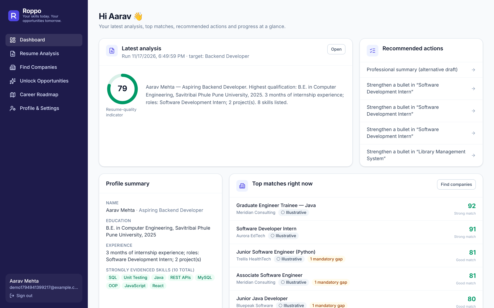
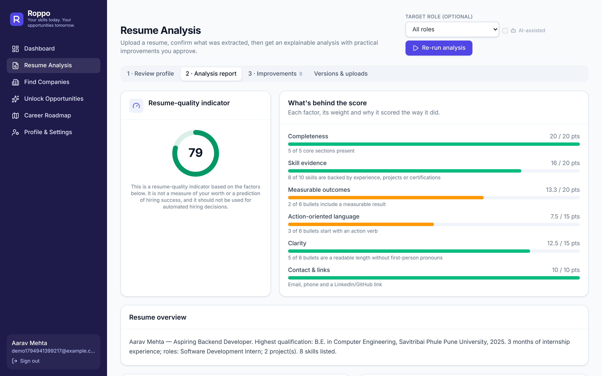
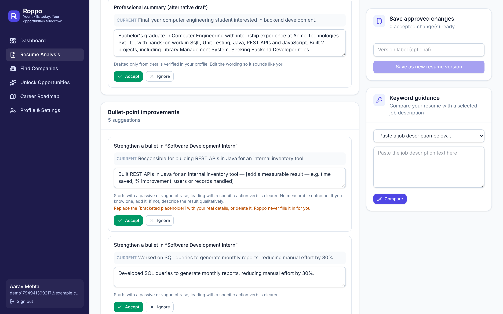
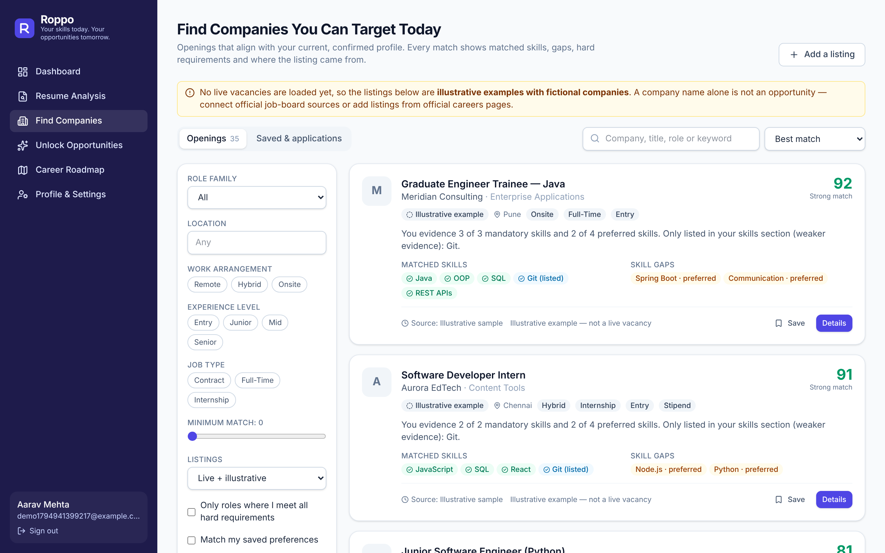
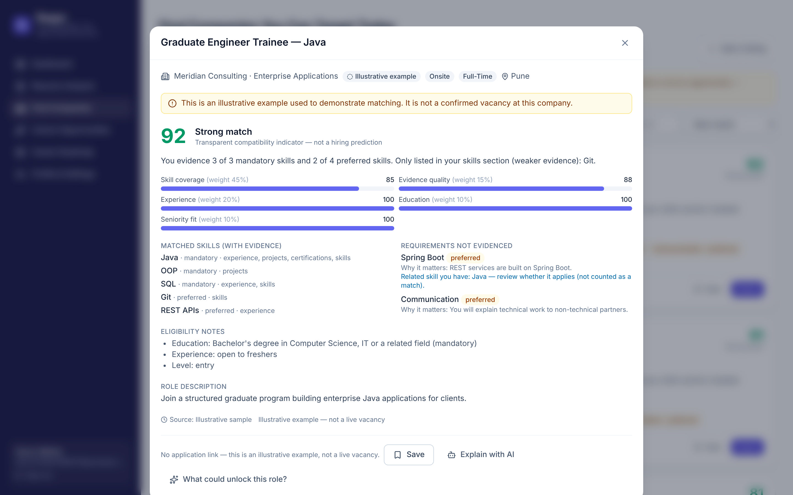
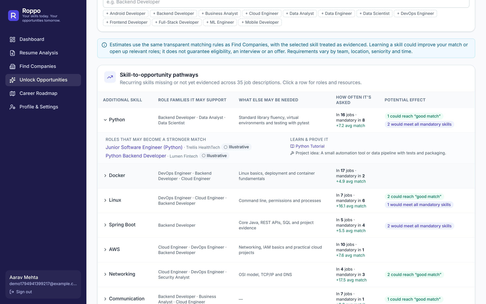
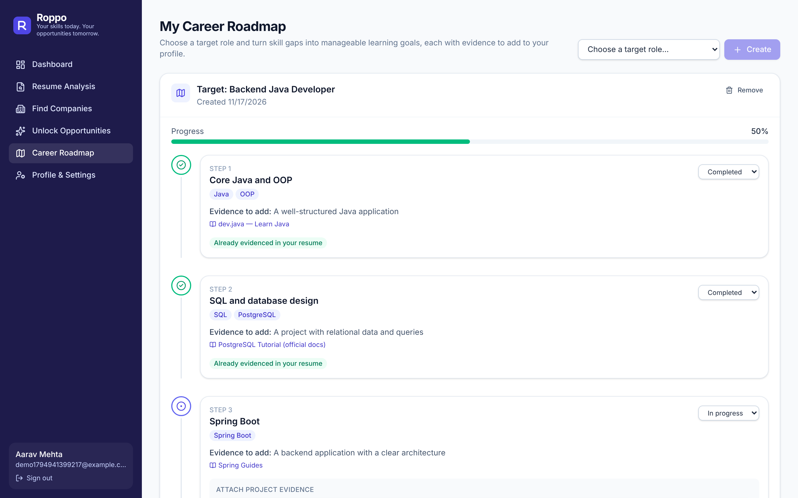

# Roppo

**AI-powered resume analyzer & career discovery platform**
*Your Skills Today. Your Opportunities Tomorrow.*


Most resume checkers return a score and a few writing tips. Roppo connects resume improvement with real job
discovery and answers three questions:

1. **Where can I apply today?** — openings that fit your current, confirmed profile, with a transparent explanation for every match.
2. **What should I improve?** — evidence-based strengths, gaps and practical edits you review and approve.
3. **What could I unlock next?** — which additional skills could expand the set of relevant roles, and a roadmap to build them.

Roppo is an *assistive* tool. It helps people make informed decisions. It never promises interviews, offers or eligibility,
and its scores are explainable indicators, not hiring decisions.



---

## Features

| Page | What it does |
|---|---|
| **Dashboard** | Latest analysis, profile summary, recommended actions, top matches, saved jobs and roadmap progress. |
| **Resume Analysis** | Upload a PDF/DOCX → review and correct the extracted profile → analysis report → approve improvements → versioned resumes. |
| **Find Companies** | Openings scored against your profile, with matched skills, gaps, hard requirements, eligibility, freshness and official apply links. Search, filters, shortlist and application tracking. |
| **Unlock Opportunities** | Recurring skill gaps across job descriptions, the role families they may open up, learning paths, and a "what if I learned X?" detail view. |
| **Career Roadmap** | A target-role roadmap. Steps you already evidence are pre-completed. Track progress, attach project evidence and add it to your profile so your matches refresh. |
| **Profile & Settings** | Personal details, job preferences, AI consent, data export, history deletion and account deletion. |

### Resume analysis
- **Extraction**: contact details, education, experience and internships (with durations), projects, skills, certifications and achievements, all shown as an **editable profile** before anything is matched.
- **Report**: overview, strengths, skill coverage (where each skill appears and how strongly it's evidenced), content quality, potential gaps for a target role.
- **Resume-quality indicator**: six weighted factors, each with its own explanation. It is labelled as an indicator, never a measure of a person's worth.
- **Improvements**: bullet rewrites, a professional summary drafted only from verified details, keyword guidance against a selected job, project presentation (problem → implementation → technology → result) and formatting feedback.
- **Never fabricates.** If a stronger bullet needs a fact Roppo doesn't have, it inserts a `[placeholder]` for you to fill in. A version containing placeholders can't be saved. "Helped write tests" becomes "Contributed to writing tests", not "Wrote tests".
- **Versioning**: your original upload is always kept. Approved changes are saved as a new version, which you can view, diff, export (DOCX/TXT) or restore.

### Matching you can inspect
- A transparent **rules-based engine** with configurable, documented weights (see [docs/scoring.md](docs/scoring.md)).
- **Hard requirements are flagged separately** (mandatory skills, minimum experience, mandatory education) and never hidden in an average.
- **Evidence matters**: a skill used in a job or project counts more than a keyword in a skills list. Skills that are only listed are marked as weaker evidence.
- **Related skills are shown for review but never counted.** For example, if you have MySQL, a PostgreSQL requirement says so, but it stays a gap.

### Vacancy-aware job data
- **Live vacancies** come from the official public job-board APIs of **Greenhouse** and **Lever**, which employers publish for this purpose. Roppo does not scrape.
- You can also add a listing you copied from an employer's **official careers page**. Its requirements are inferred from the description.
- Every listing shows its **source, last-checked date and status**. Listings that disappear at the source are marked closed.
- The demo dataset uses **fictional companies**, and every listing is labelled *"Illustrative example — not a live vacancy"*. A company name alone is not an opportunity.

### Optional AI (Claude)
Everything works without AI. If the server has an `ANTHROPIC_API_KEY` **and** a user opts in, Claude:
- explains the engine's findings in plain language, and
- suggests clearer wording for flagged bullets and the summary.

Safeguards: contact details and links are removed before sending, and the LLM never invents requirements or judges suitability.
Every AI rewrite passes a **grounding check**: if it adds numbers or skills that aren't in your resume, it is discarded and the rules-based suggestion is kept.

---

## Screenshots

| Analysis report | Improvements you approve |
|---|---|
|  |  |
| **Find Companies** | **Job detail: explainable match** |
|  |  |
| **Unlock Opportunities** | **Career Roadmap** |
|  |  |

*All screenshots use fictional sample data.*

---

## Tech stack

| Layer | Technology |
|---|---|
| Frontend | React 19, React Router, Tailwind CSS 4, Vite |
| Backend API | Python 3.13, FastAPI, Pydantic |
| Resume parsing | PyMuPDF (PDF), python-docx (DOCX) |
| NLP | Rules-based section and entry parser plus a curated skill taxonomy (~100 skills, aliases, related skills, learning resources) |
| LLM (optional) | Claude via the Anthropic Python SDK, with structured outputs |
| Database | PostgreSQL (Docker) or SQLite (zero-setup local dev), SQLAlchemy 2 |
| Auth | JWT bearer tokens, bcrypt password hashing |
| Deployment | Docker, docker-compose, nginx |
| Automation | GitHub Actions (tests + frontend build) |

Architecture, data flow and the database schema are documented in [docs/architecture.md](docs/architecture.md).

---

## Getting started

### Option A — Docker (PostgreSQL + API + web)

```bash
cp .env.example .env        # set ROPPO_JWT_SECRET; optionally ANTHROPIC_API_KEY
docker compose up --build
```

Open <http://localhost:8080>. The API runs on <http://localhost:8000>, with interactive docs at <http://localhost:8000/docs>.

### Option B — Local development

**Backend** (uses SQLite by default):

```bash
python -m venv .venv && source .venv/bin/activate
pip install -r backend/requirements-dev.txt
cd backend && uvicorn app.main:app --reload
```

**Frontend** (in a second terminal; proxies `/api` to `localhost:8000`):

```bash
cd frontend && npm install && npm run dev
```

Open <http://localhost:5173>, create an account and upload one of the fictional resumes in [`samples/`](samples/).

### Run the tests

```bash
pytest
```

The suite covers parsing and file validation, extraction, matching and scoring rules, improvement grounding, the LLM grounding guard, job-source sync (with mocked HTTP) and an end-to-end API journey.

### Configuration

All settings are environment variables. See [`.env.example`](.env.example).

| Variable | Purpose |
|---|---|
| `ROPPO_JWT_SECRET` | Token signing secret (required in production) |
| `ROPPO_DATABASE_URL` | SQLAlchemy URL (defaults to SQLite) |
| `ANTHROPIC_API_KEY` | Enables optional AI explanations (users must also opt in) |
| `ROPPO_LLM_MODEL` | Claude model ID (default `claude-opus-5-5`) |
| `ROPPO_GREENHOUSE_BOARDS` / `ROPPO_LEVER_COMPANIES` | Comma-separated public job boards to sync live vacancies from |
| `ROPPO_SEED_SAMPLE_JOBS` | Seed the fictional, clearly labelled demo listings |
| `ROPPO_FRESHNESS_DAYS` | Age after which a live listing is flagged as "needs re-checking" |

---

## Project structure

```
Roppo/
├── frontend/              React app
│   └── src/{components,pages,services}/
├── backend/
│   └── app/
│       ├── main.py        FastAPI app
│       ├── routes/        auth, resumes & profile, analysis, jobs, career (opportunities, roadmap, dashboard, settings)
│       ├── services/      parsing, extraction, skills, analysis, improvement, matching,
│       │                  opportunities, roadmap, llm, jobsources, export
│       ├── models/        SQLAlchemy models
│       ├── data/          skill taxonomy, fictional demo jobs
│       └── utils/         security (JWT, hashing)
├── tests/                 pytest suite
├── samples/               fictional resumes (PDF + DOCX) and their generator
├── docs/                  architecture, scoring, API
├── screenshots/
├── docker-compose.yml
└── .env.example
```

---

## Privacy & responsible AI

- Resumes are treated as sensitive personal documents. Uploads are stored privately on disk, never served as static files, and are only available to their owner.
- Files are checked by size, extension **and** content signature. Macro-enabled DOCX files and zip bombs are rejected. Uploaded content is never executed.
- Logs record metadata only, never resume text or contact details.
- Users can export all their data, delete their analysis history, delete individual resumes, or delete their account (which also removes uploaded files).
- AI processing requires explicit consent. Contact details are redacted first.
- Compatibility scores are not automated hiring decisions or guarantees.
- Job information shows its source and last-verified date. Live vacancies are clearly distinguished from illustrative examples.
- Job data comes from permitted official APIs or official careers pages, never from scraping.

---

## Roadmap

- [x] Accounts, PDF/DOCX upload and extraction, editable profile
- [x] Explainable analysis, approval workflow, resume versions and export
- [x] Transparent job matching, Find Companies, saved jobs and application tracking
- [x] Unlock Opportunities: skill-gap engine and skill-to-role pathways
- [x] Career roadmap with evidence-to-profile loop
- [x] Live vacancies from official Greenhouse and Lever job-board APIs
- [ ] Semantic matching with sentence embeddings (surfaced for review, never auto-counted)
- [ ] Side-by-side resume version comparison
- [ ] Job alerts and scheduled live-job refresh
- [ ] Interview preparation from a selected job description
- [ ] Evaluation set of manually reviewed matches to track false positives and false negatives
