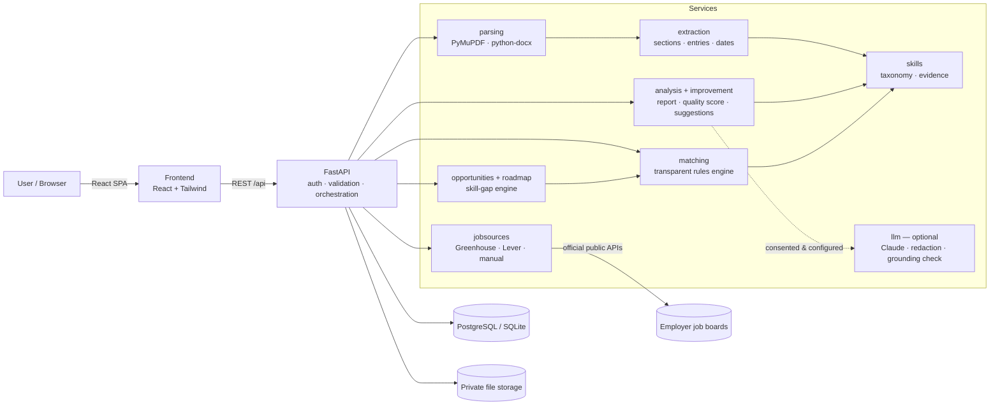
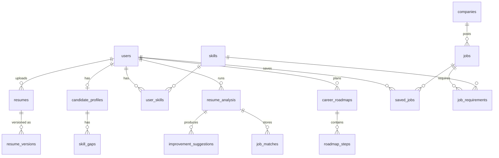

# Architecture

Roppo is a modular full-stack web app. Document parsing, resume analysis, job matching and LLM feedback are separate
services, so each can be tested and improved independently.

## Data flow

| Step | Process |
|---|---|
| 1 | The user uploads a resume and sets career preferences. |
| 2 | FastAPI validates the file (size, extension, content signature) and stores it privately. |
| 3 | The parser extracts text. Extraction structures contact, education, experience, projects, skills, certifications and achievements. |
| 4 | The user reviews and corrects the candidate profile. |
| 5 | The matching engine compares the profile with job requirements and computes explainable results. |
| 6 | Optionally, the LLM explains findings and polishes wording, using only the extracted evidence (grounding-checked). |
| 7 | The frontend displays current matches, future opportunities and roadmap actions. |
| 8 | The database stores profile data, analysis history and saved opportunities. |

## Service responsibilities

| Module | Responsibility |
|---|---|
| `services/parsing.py` | File validation and PDF/DOCX text extraction |
| `services/extraction.py` | Section detection, entry segmentation, dates, durations and degree levels |
| `services/skills.py` | Skill identification with evidence location and strength |
| `data/skills.py` | Curated taxonomy: aliases, related skills, role families, "also needed", resources and project ideas |
| `services/analysis.py` | Report sections and the resume-quality indicator |
| `services/improvement.py` | Bullet rewrites, summary, keyword guidance, project presentation, formatting feedback |
| `services/matching.py` | Job compatibility scoring, hard-requirement flags and preference fit |
| `services/opportunities.py` | Recurring gaps, learning paths, role-family uplift and opportunity detail |
| `services/roadmap.py` | Target-role roadmap templates |
| `services/llm.py` | Optional Claude integration: consent, redaction, structured outputs and grounding check |
| `services/jobsources.py` | Demo seed data, Greenhouse/Lever sync, requirement inference and freshness |
| `services/export.py` | Render resume versions as DOCX and TXT |

## Database

| Table | Key fields |
|---|---|
| users | id, name, email, password_hash, ai_consent, preferences, created_at |
| resumes | id, user_id, filename, storage_reference, extracted_text_reference |
| resume_versions | id, resume_id, version_number, source (original/approved_changes), content, applied_changes |
| candidate_profiles | id, user_id, data (JSON), education_summary, experience_summary, confirmed |
| skills | id, canonical_name, skill_category |
| user_skills | user_id, skill_id, evidence, evidence_strength, proficiency_self_reported |
| companies | id, name, careers_url, website, is_illustrative |
| jobs | id, company_id, title, location, work_mode, seniority, source, source_url, listing_type, status, last_verified_at |
| job_requirements | job_id, skill_id, requirement_type (mandatory/preferred), description |
| resume_analysis | id, resume_id, profile_id, target_role, score_details, report, llm_used |
| improvement_suggestions | analysis_id, category, original, suggested, status, final_text, source |
| job_matches | analysis_id, job_id, score, score_details, explanation |
| skill_gaps | profile_id, skill_id, priority, related_job_ids |
| career_roadmaps / roadmap_steps | target_role, status / skills, learning_focus, evidence_to_add, status, evidence |
| saved_jobs | user_id, job_id, saved_at, application_status, notes |

Tables are created on startup. For a production deployment with schema changes over time, add Alembic migrations.
